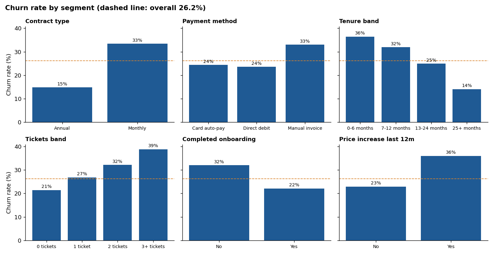
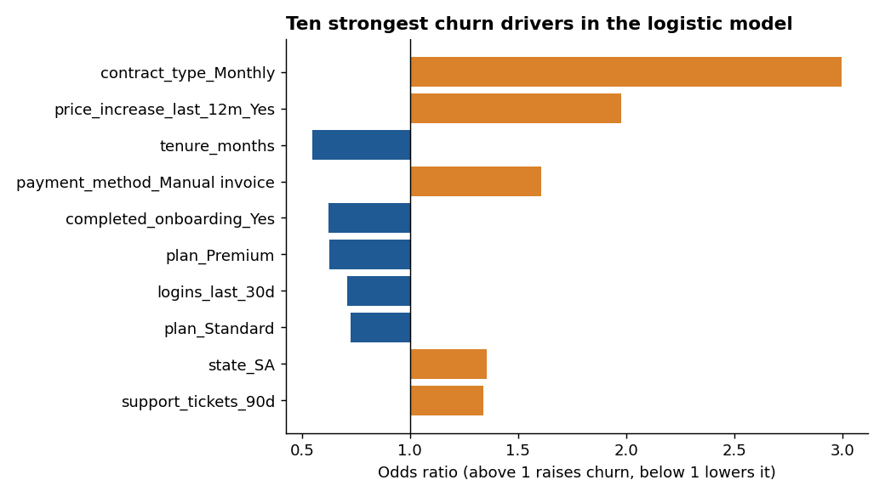
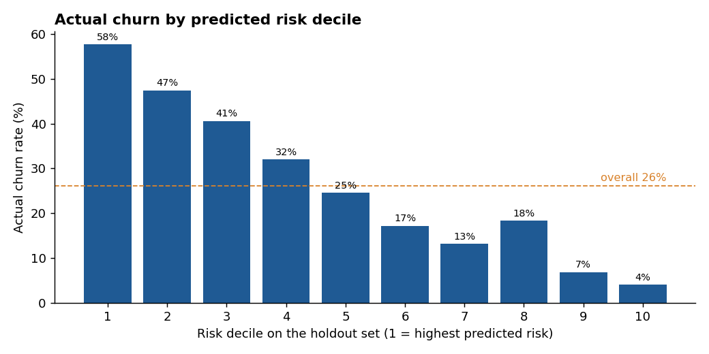
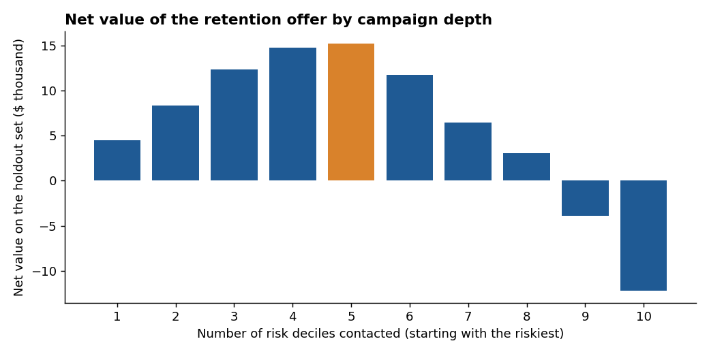
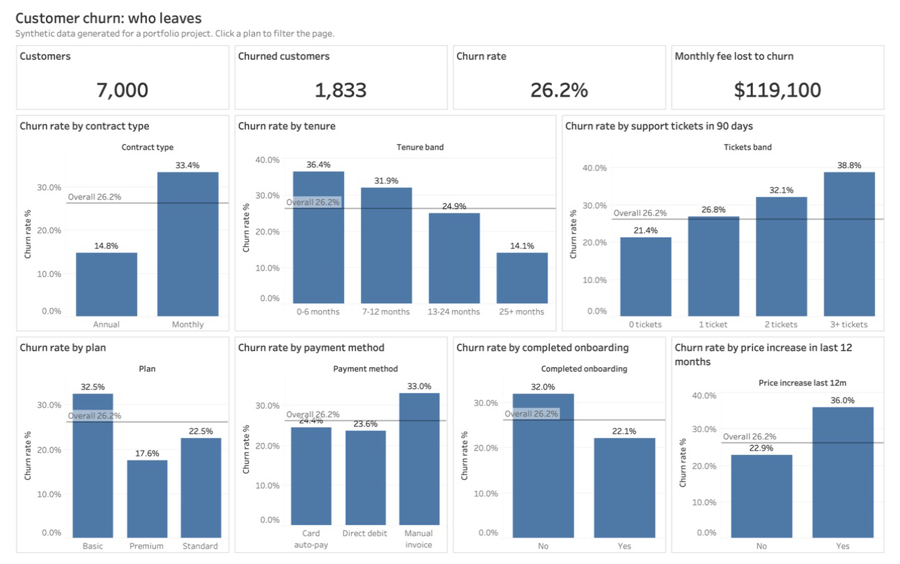

# Customer churn analysis and retention business case

A subscription software business is losing about one customer in four. The retention team asked two questions. Which customers leave, and is a retention offer worth paying for?

I cleaned the data, tested which differences are real, built a simple model to rank customers by risk, and costed the offer at different campaign sizes.

The data is synthetic. I wrote a generator with a fixed seed for a fictional company that sells bookkeeping software to small firms. The churn drivers were put into the data by me, so this project shows my method. It does not report on a real company.

## Tools

Python with pandas, SciPy for the hypothesis tests, scikit-learn for the logistic regression and matplotlib for the charts.

## The data

One row per customer, 7,000 customers, 14 columns. The columns cover plan, contract type, payment method, seats, monthly fee, tenure, logins in the last 30 days, support tickets in the last 90 days, onboarding, price increases and whether the customer churned.

Two problems were found during cleaning. Login counts were missing for 222 customers (3.2%), and payment method had six spellings for three values because some were stored in capitals. Missing logins were filled with the median for the customer's plan, and a flag column records which rows were filled.

## Findings

### Churn is 26.2% and it is concentrated in a few groups

| Group | Churn rate | Compared with |
|---|---|---|
| Monthly contract | 33.4% | Annual 14.8% |
| First 6 months | 36.4% | 25 months or more 14.1% |
| Price increase in the last year | 36.0% | No increase 22.9% |
| Pays by manual invoice | 33.0% | Card auto-pay 24.4% |
| Did not complete onboarding | 32.0% | Completed 22.1% |
| 3 or more support tickets | 38.8% | No tickets 21.4% |



### Ten of twelve differences are statistically significant

I used a chi-square test for the categorical columns and a Mann-Whitney U test for the numeric ones, because the numeric columns are skewed counts. Twelve tests were run, so the p-values are Bonferroni adjusted.

Ten columns passed at the 0.05 level. State and industry did not. With 7,000 rows even small differences pass a significance test, so I also report effect sizes. Tenure (rank-biserial r of -0.24) and contract type (Cramer's V of 0.21) are the strongest. Monthly fee is significant but weak at -0.09.

The full table is in [03_hypothesis_tests.csv](reports/tables/03_hypothesis_tests.csv).

### The model ranks customers well enough to target an offer

A logistic regression was trained on 75% of customers and tested on the other 25%. ROC AUC on the test set is 0.747.

When the other columns are held constant, a monthly contract triples the odds of churn (odds ratio 3.0). A price increase doubles the odds (1.98). Completed onboarding lowers the odds by 38% (0.62).

South Australia appears in the top ten with an odds ratio of 1.36. I do not trust it. State failed the significance test, and the generator gives state no effect on churn, so this coefficient is noise.



The riskiest 10% of test customers churned at 57.7%, which is 2.2 times the overall rate. The riskiest 30% contain 56% of all churners.



## Business case for a retention offer

The offer is costed with three assumptions of mine. It costs $60 per customer contacted, it saves 25% of the customers who would have left, and a saved customer stays 12 more months.

On the 1,750 test customers, contacting the riskiest half gives the highest net value at $15,198. Return on spend is highest when only the top 10% is contacted (43%) and falls with every extra decile. Contacting everyone loses $12,176.



The result depends heavily on the save rate. The table shows the best net value available under other assumptions. A negative number means the offer loses money at every campaign size.

| | Cost $40 | Cost $60 | Cost $80 | Cost $100 |
|---|---|---|---|---|
| Save rate 10% | -$990 | -$4,490 | -$7,990 | -$11,490 |
| Save rate 15% | $6,050 | -$1,485 | -$4,985 | -$8,485 |
| Save rate 25% | $32,777 | $15,198 | $1,881 | -$2,475 |
| Save rate 35% | $65,912 | $42,278 | $24,778 | $9,450 |

At a $60 offer the campaign loses money with a 15% save rate and makes money with 25%. The real save rate is not known yet.

## Recommendations

1. Pilot the offer on the riskiest 10% first, with a control group that gets no offer. The pilot measures the real save rate, which is the number the whole business case depends on.
2. Move monthly customers to annual contracts with a discount at month three. Contract type is the strongest driver and the first six months are the riskiest.
3. Contact customers before a price increase takes effect. A price increase doubles the odds of churn.
4. Follow up customers who have not completed onboarding within 30 days. Uncompleted onboarding is common (41% of customers) and can be fixed.
5. Move manual invoice customers to auto-pay where they agree to it.

## Limits of this analysis

The model shows association, not cause. Customers on annual contracts may be more committed to begin with, so moving a customer to annual may not lower churn by the full amount the odds ratio suggests.

The offer cost, save rate and months saved are assumptions. The dollar figures are for the 1,750 test customers only and would be about four times larger for the full base.

## Dashboard

The churn results are also built as a Tableau workbook with three dashboards. The workbook, screenshots and the Power BI build pack are in the [dashboard](dashboard/README.md) folder.



## How to run it

```bash
pip install -r requirements.txt
python src/generate_data.py
python src/churn_analysis.py
```

The analysis script writes seven tables to `reports/tables/` and four charts to `reports/figures/`.

## Repository layout

```
data/               subscriptions.csv (synthetic)
src/                data generator and analysis script
reports/tables/     data quality, segment rates, tests, odds ratios, lift, campaign, sensitivity
reports/figures/    charts
dashboard/          Tableau workbook, screenshots and Power BI build pack
```

## Business analyst skills shown

| Skill | Where |
|---|---|
| Framing a stakeholder question as an analysis | The two questions at the top |
| Data cleaning with a record of what changed | [01_data_quality.csv](reports/tables/01_data_quality.csv) |
| Choosing a statistical test and reporting effect size | Hypothesis tests |
| Building a business case with stated assumptions | Retention offer section |
| Sensitivity analysis | Save rate and cost table |
| Separating association from cause | Limits section and the South Australia note |
