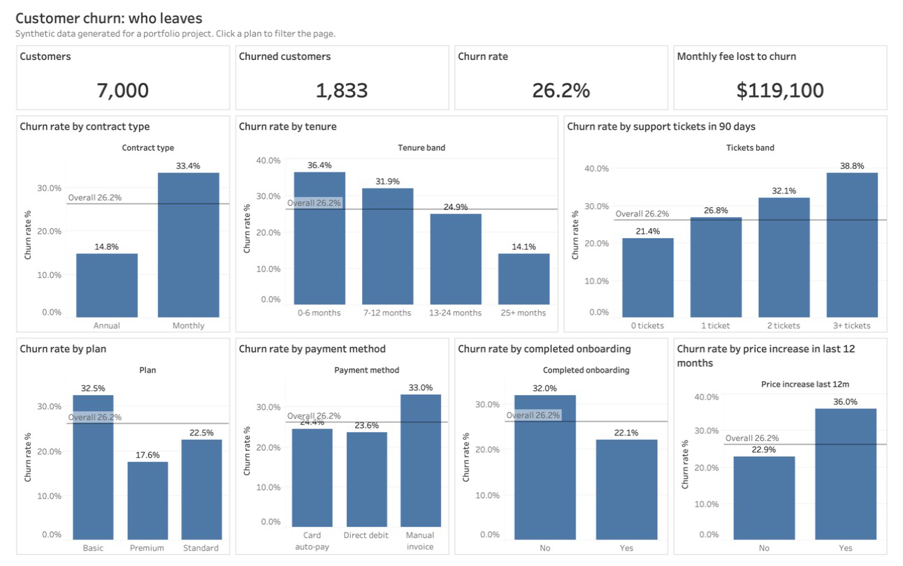
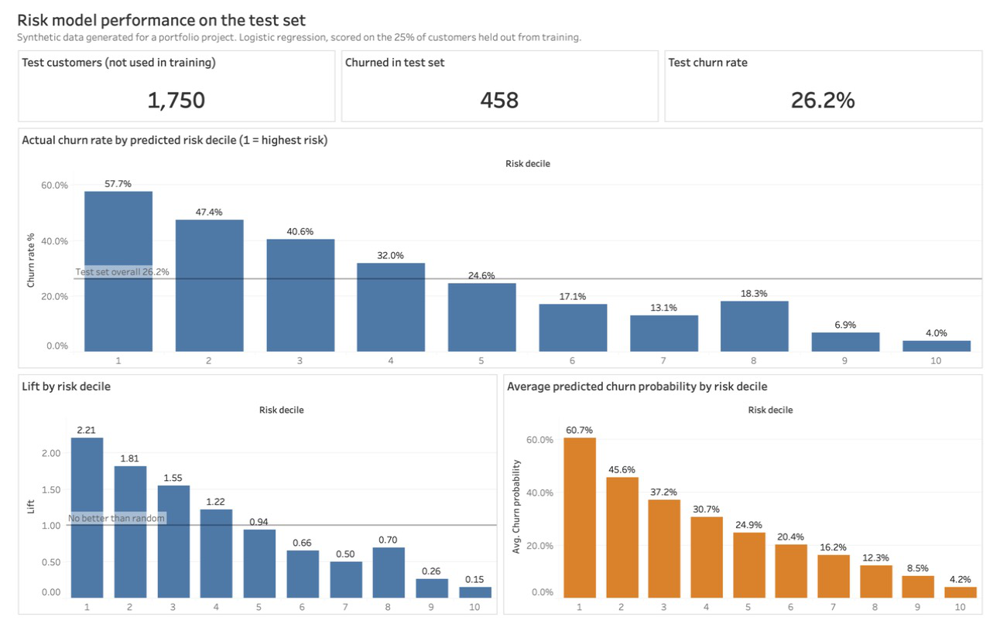
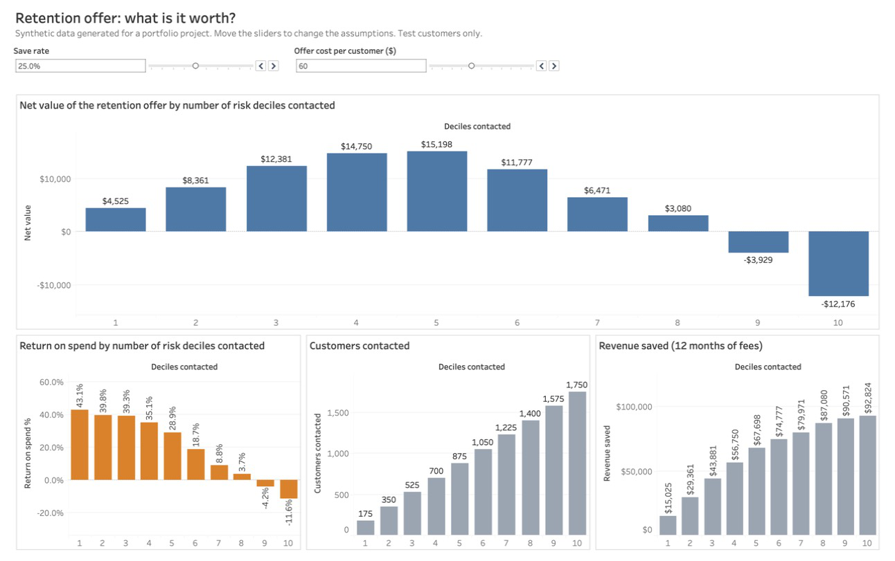

# Dashboards: customer churn

The Tableau workbook for this project is built and is in `tableau/customer_churn_dashboard.twbx`. It has three dashboards. The Power BI version is not built yet, because Power BI Desktop needs Windows. Everything needed to build it is in this folder.

## Tableau workbook

Open `tableau/customer_churn_dashboard.twbx` in Tableau Public or Tableau Desktop. The data is packaged inside the file as extracts, so nothing else is needed. Click a plan on the first page to filter it. On the third page, two sliders change the save rate and the offer cost.

I did not build the workbook by dragging fields in Tableau. `tableau/build_workbook.py` writes the workbook file from the dashboard data, and `tableau/twb_builder.py` holds the shared code. Tableau Public only opens workbooks that use extracts, so the script writes each table to a `.hyper` extract with Tableau's Hyper API. After each build I opened the workbook in Tableau Public 2026.3 and compared every page with the check values at the end of this file.

To rebuild it:

```bash
pip install tableauhyperapi
python dashboard/tableau/build_workbook.py
```

To publish it, open the workbook and choose File, then Save to Tableau Public As.

### Who churns



### Risk model



### Retention offer



## Files

| File | Use |
|---|---|
| `data/customers_scored.csv` | One row per customer, 7,000 rows, with bands, churn probability and risk decile |
| `tableau/` | Tableau workbook and the scripts that build it |
| `screenshots/` | Dashboard screenshots |
| `measures.dax` | Power BI measures |
| `portfolio_theme.json` | Power BI colour theme |

The CSV is written by `python src/export_dashboard_data.py`. The script checks that the test-set deciles match the lift table from the analysis.

## Columns added for the dashboard

| Column | Meaning |
|---|---|
| `tenure_band`, `tickets_band` | Bands used in the segment charts |
| `churn_probability` | Score from the logistic model |
| `dataset` | Train or Test. The model was trained on the Train rows |
| `risk_decile` | 1 is the riskiest tenth, ranked inside each dataset |
| `annual_fee` | Monthly fee times 12 |

Scores for Train customers are in-sample. Pages 2 and 3 should be filtered to `dataset = Test`, otherwise the model looks better than it is.

## Pages for Power BI

### Page 1. Who churns

| Visual | Fields |
|---|---|
| Cards | Customers, Churned Customers, Churn Rate %, Monthly Fee Lost |
| Six bar charts | Churn Rate % by `contract_type`, `payment_method`, `tenure_band`, `tickets_band`, `completed_onboarding`, `price_increase_last_12m`. Add Overall Churn Rate % as a constant line |
| Slicers | `plan`, `industry`, `state` |

Sort `tenure_band` and `tickets_band` by hand so the bands run in order.

### Page 2. Risk model (Test customers only)

| Visual | Fields |
|---|---|
| Column chart | `risk_decile` on the axis, Churn Rate % as the value, Overall Churn Rate % as a line |
| Column chart | `risk_decile` on the axis, Lift as the value |
| Table | The 50 customers with the highest `churn_probability`, with plan, contract type, tenure and monthly fee |

### Page 3. Retention offer (Test customers only)

| Visual | Fields |
|---|---|
| Slicers | Save Rate and Offer Cost what-if parameters |
| Column chart | `risk_decile` on the axis, Net Value Cumulative as the value |
| Table | `risk_decile`, Customers Contacted Cumulative, Net Value Cumulative, Campaign ROI % |

The chart reads as "net value if the campaign contacts this decile and every riskier one".

## Tableau calculated fields

These are the calculations used in the workbook, written as you would type them in Tableau. The steps below are for building the same dashboard by hand.

Connect to `customers_scored.csv`. Create two parameters, `Save Rate` (float, 0.05 to 0.5, default 0.25) and `Offer Cost` (integer, 20 to 120, default 60). Then create these calculated fields.

| Name | Formula |
|---|---|
| Churn Rate % | `SUM([Churned]) / COUNT([Customer Id])` |
| Overall Churn Rate % | `{ FIXED [Dataset] : SUM([Churned]) / COUNT([Customer Id]) }` |
| Lift | `[Churn Rate %] / MIN([Overall Churn Rate %])` |
| Monthly Fee Lost | `SUM(IF [Churned] = 1 THEN [Monthly Fee] END)` |
| Net Value | `[Save Rate] * SUM(IF [Churned] = 1 THEN [Annual Fee] END) - [Offer Cost] * COUNT([Customer Id])` |
| Net Value Cumulative | `RUNNING_SUM([Net Value])` computed along `Risk Decile` |

`Overall Churn Rate %` is fixed on `Dataset`, so slicers on plan or industry will not change it unless they are added to context.

## Numbers the dashboard must match

| Measure | Filter | Value |
|---|---|---|
| Customers | None | 7,000 |
| Churn rate | None | 26.2% |
| Churn rate, monthly contract | None | 33.4% |
| Customers and churners | Test | 1,750 and 458 |
| Churn rate in decile 1 | Test | 57.7% |
| Lift in decile 1 | Test | 2.2 |
| Net Value Cumulative at decile 5 | Test, save rate 0.25, offer cost 60 | $15,198 |
| Net Value Cumulative at decile 10 | Test, save rate 0.25, offer cost 60 | -$12,176 |
